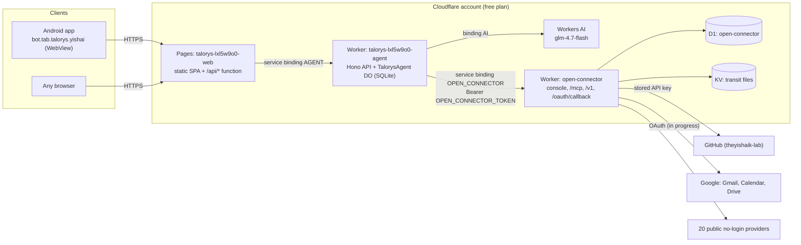

# Architecture

Talorys is Yishai's private, single-owner AI assistant (chat, memory, tasks, notes, reminders,
automations). It runs entirely on one **free Cloudflare account**, with no card on file. Since
October 13, 2026 it can also reach outside apps (GitHub today, Google next) through
**OpenConnector**, a self-hosted auth gateway running in the same account.

## The pieces

| Piece | What it is | Where it runs | Source |
| --- | --- | --- | --- |
| **Web app** | React single-page app + a tiny `/api` proxy function | Cloudflare Pages project `talorys-lxl5w9o0-web` → https://talorys-lxl5w9o0-web.pages.dev | `apps/web` in this repo |
| **Agent** | The backend: Hono HTTP API + `TalorysAgent` Durable Object with its own SQLite database; runs the AI loop and the tools | Worker `talorys-lxl5w9o0-agent` (private, no public URL) | `apps/agent` in this repo |
| **AI model** | `@cf/zai-org/glm-4.7-flash` | Workers AI (binding `AI`), free daily allocation | — |
| **OpenConnector** | Auth gateway: holds the credentials of outside apps, exposes ~14,700 actions of ~1,420 providers over MCP and HTTP, has a web console | Worker `open-connector` → https://open-connector.yishai-kaminsky.workers.dev, D1 database `open-connector`, KV namespace `open-connector-transit-files` | [theyishaik-lab/open-connector](https://github.com/theyishaik-lab/open-connector), branch `main` |
| **Android app** | Full-screen WebView wrapper around the web app | Yishai's phone, package `bot.tab.talorys.yishai` | [theyishaik-lab/talorys-android](https://github.com/theyishaik-lab/talorys-android) (private) |
| **Shared code** | Zod schemas, constants, recurrence rules, crypto helpers | bundled into web + agent | `packages/shared` |
| **Installer** | `create-talorys` CLI (the original one-command install) | used once, Oct 12, 2026 | `packages/create-talorys` |

## Diagram



Plain-text version:

```
 Android app / browser
        |  HTTPS
        v
 Pages  talorys-lxl5w9o0-web  (static React app; /api/* -> Pages Function)
        |  service binding AGENT
        v
 Worker talorys-lxl5w9o0-agent  (Hono API -> TalorysAgent Durable Object + SQLite)
        |-- binding AI ----------------> Workers AI  @cf/zai-org/glm-4.7-flash
        |-- service binding OPEN_CONNECTOR + Bearer OPEN_CONNECTOR_TOKEN
        v
 Worker open-connector  (MCP /mcp, HTTP /v1, admin /api, console /, /oauth/callback)
        |-- D1 "open-connector" (connections, encrypted credentials, OAuth configs, run log)
        |-- KV "open-connector-transit-files" (file hand-offs, max 25 MiB)
        v
 GitHub (connected) · Google (in progress) · 20 public providers
```

## How a chat message flows

1. The browser or Android app loads the static app from Pages. Every API call goes to
   `/api/*` on the same origin, with the session cookie `__Host-talorys_session` (30 days) and the
   CSRF header `x-talorys-request: 1`.
2. The Pages Function (`apps/web/functions/api/[[path]].ts`) forwards the original request,
   untouched, to the agent Worker through the `AGENT` service binding. The agent Worker has no public
   URL — Pages is the only way in.
3. The Worker routes `/api/*` to the single Durable Object instance `personal-agent`, which runs the
   Hono app next to its SQLite database (all tables prefixed `tal_`).
4. For a chat message, `agent/runner.ts` builds the context (system prompt, relevant memories,
   summary, recent history), calls the model with the tool list, executes tool calls, and streams the
   answer back as Server-Sent Events.
5. Limits per request (owner-adjustable in Settings → AI, defaults in
   `packages/shared/src/constants.ts`): 10 tool calls, 8 model steps, 6,000 context tokens,
   1,024 output tokens; 200 AI requests and 6 scheduled AI runs per day.

## How Talorys talks to OpenConnector

Code: `apps/agent/src/openconnector/` (`client.ts`, `tools.ts`, `index.ts`), tests in
`apps/agent/test/openconnector.test.ts`.

- **Transport:** JSON-RPC `tools/call` to OpenConnector's stateless MCP endpoint `POST /mcp`. In
  production the request goes through the **service binding `OPEN_CONNECTOR`** (Worker-to-Worker
  inside the account, no public hop). Without a binding the client can use the var
  `OPEN_CONNECTOR_URL` instead.
- **Auth:** header `Authorization: Bearer <OPEN_CONNECTOR_TOKEN>`. That Worker secret holds an
  OpenConnector **runtime token** — it can run actions on connections that exist, but cannot read
  credentials or change OpenConnector's configuration (that needs the separate admin token).
- **Switch:** the tools exist only when `OPEN_CONNECTOR_TOKEN` is set *and* either the binding or the
  URL is present. Then the system prompt's "you cannot access accounts" rule is replaced by
  `CONNECTOR_RULE` (`agent/prompt.ts`).
- **Result size:** every result is compacted (nulls, empty fields, API-link fields, ids, etags removed)
  and then cut at 3,500 characters before it reaches the model (`compactResult` / `truncateResult`).

### The five connector tools

| Tool | Permission | What it does | MCP tool behind it |
| --- | --- | --- | --- |
| `connected_apps` | read | Lists connected accounts and the public services that need no login | `list_connections` |
| `search_actions` | read | Finds action ids in the catalog, e.g. `gmail.search_threads`, with `read_only` and `ready` flags | `search_actions` |
| `action_guide` | read | Exact input parameters of one action | `get_action_guide` |
| `run_action` | read | Runs an action whose name starts with a read verb (get, list, search, fetch, find, read, query, lookup, count, check, describe, retrieve, show, view, browse, preview, download, export, resolve, validate, verify, ping). Anything else is refused with "use propose_action" | `execute_action` |
| `propose_action` | destructive | Anything that sends, creates, edits or deletes. It only creates an approval request | `execute_action` (after approval) |

Scheduled runs (automations) only get the read tools.

### Approval flow and the bell

```
model calls propose_action(action, input)
   -> a pending action row (table tal_pending_actions), valid 30 minutes
   -> the chat shows an approval card: "Approve" / "Cancel"  ("Nothing changes unless you approve.")
owner taps Approve  -> POST /api/actions/:id/approve        (owner's session only;
                                                       the model cannot call it)
   -> execute_action runs once through OpenConnector
   -> activity log entry "connector.action"
   -> a notification "Done" with a short result excerpt -> the bell icon (NotificationCenter)
owner taps Cancel   -> POST /api/actions/:id/cancel        -> nothing runs
```

The card shows the final state ("Approved and done", "Approved, but it failed", cancelled, expired).
The bell list refreshes every 30 seconds while the app is open. There are no push notifications —
neither on the web nor in the Android app.

## OpenConnector itself

- Fork of [oomol-lab/open-connector](https://github.com/oomol-lab/open-connector) v1.4.0, plus two
  commits: Yishai's "per-account grants and key-named run audit" (`6788fec3`) and a build fix for the
  provider-icon catalog (`4d5a7bc3`). The deployed code is exactly `main` of
  `theyishaik-lab/open-connector`.
- Endpoints on https://open-connector.yishai-kaminsky.workers.dev :
  `/` web console (admin token) · `/health` · `/mcp` and `/v1/*` (runtime token) ·
  `/api/*` admin API (admin token) · `/oauth/callback` (OAuth redirect for every provider) ·
  `/docs`, `/openapi.json`.
- Storage: D1 `open-connector` (all 11 migrations applied) holds connections, credentials and OAuth
  client configs **encrypted with `OOMOL_CONNECT_ENCRYPTION_KEY`**, plus the run log. KV
  `open-connector-transit-files` replaces R2 for file hand-offs (R2 would need a card), files up to
  25 MiB (`TRANSIT_FILES_BACKEND=kv`).
- Without `OOMOL_CONNECT_RUNTIME_TOKEN` the `/mcp` and `/v1` endpoints would be open to anyone; with
  it they answer 401 to unauthenticated calls (verified).

## Repositories and branches

All under the GitHub account **theyishaik-lab** (Yishai's project account). Tab never writes to
Yishai's personal account `yishaik`.

| Repo | Visibility | Branches | What is deployed |
| --- | --- | --- | --- |
| [theyishaik-lab/talorys](https://github.com/theyishaik-lab/talorys) | public | `main` (deployable), `feat/openconnector` (merged into main) | Agent Worker = `main` (commit `20f4a6f`, deployed Oct 13 02:05 IL). Web = the installer's published 0.1.5 build, *not yet* `main` (see ROADMAP.md) |
| upstream [rociiu/talorys](https://github.com/rociiu/talorys) | public | `main` | remote `upstream` in the local clone |
| [theyishaik-lab/open-connector](https://github.com/theyishaik-lab/open-connector) | public | `main` (= deployed), `upstream-main` (upstream's newer main, 330 commits ahead, not merged) | Worker `open-connector` = `main` @ `4d5a7bc3`, deployed Oct 13 00:18 IL |
| [theyishaik-lab/talorys-android](https://github.com/theyishaik-lab/talorys-android) | private | `main` | APK v1.0 (versionCode 1) |

## Data and state

| What | Where |
| --- | --- |
| Chats, memories, tasks, notes, automations, notifications, settings, sessions, usage | SQLite inside the `TalorysAgent` Durable Object (one instance, `personal-agent`). Back up from Settings → Privacy → Download backup (`/api/export`). |
| App settings such as timezone (`Asia/Jerusalem`) and AI limits (10 tool calls / 8 steps) | `tal_settings` in that database (changed in Settings; the Worker var `TALORYS_DEFAULT_TIMEZONE=UTC` is only the first-run default) |
| Connected accounts, OAuth client configs, run audit | OpenConnector's D1 database, encrypted |
| Secrets | Worker secrets on Cloudflare + Tab's private secret store — see SECRETS.md |

## Free-tier facts that shape the design

- Workers free plan: compressed Worker size limit 3 MiB. The agent bundle is ~632 KiB gzip; the
  OpenConnector bundle is ~3,034 KiB of 3,072 KiB — almost full.
- Workers free plan CPU: 10 ms per request (waiting on network does not count).
- Workers AI free allocation is a daily Neuron budget; Talorys also enforces its own 200 requests/day.
- No R2, no Vectorize, no paid add-ons. Everything else (D1, KV, Durable Objects with SQLite, Pages)
  is on the free plan.
